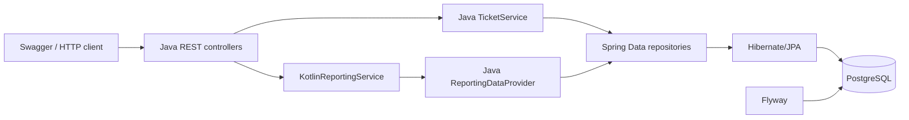
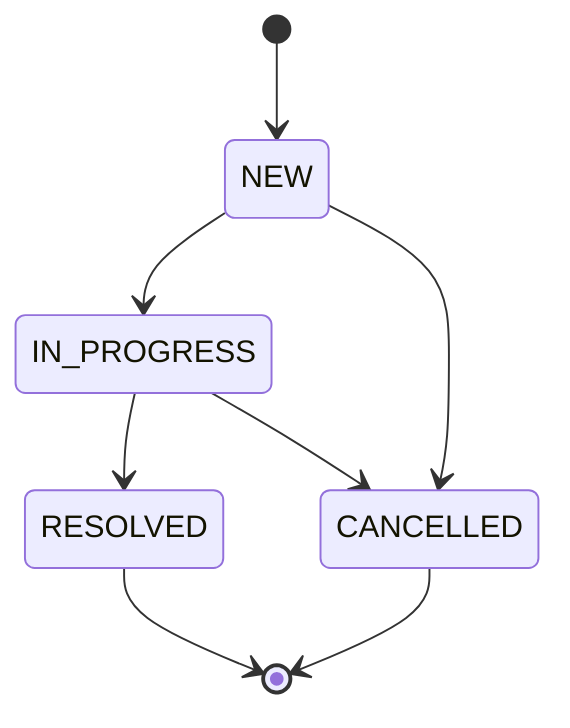
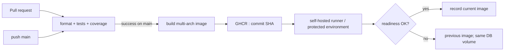

# Архитектура и диаграммы

## Компоненты



## ER-модель

```mermaid
erDiagram
  CATEGORY ||--o{ TICKET : classifies
  TICKET ||--o{ TICKET_STATUS_HISTORY : records
  CATEGORY { bigint id PK; varchar name UK; varchar description }
  TICKET { bigint id PK; varchar title; varchar description; bigint category_id FK; varchar priority; varchar status; timestamptz created_at; timestamptz due_at; timestamptz closed_at; timestamptz updated_at; bigint version }
  TICKET_STATUS_HISTORY { bigint id PK; bigint ticket_id FK; varchar old_status; varchar new_status; timestamptz changed_at }
```

## Жизненный цикл



`RESOLVED` и `CANCELLED` терминальны. Статус и история меняются в одной транзакции; optimistic version превращает конкурентный конфликт в HTTP 409.

## CI/CD


